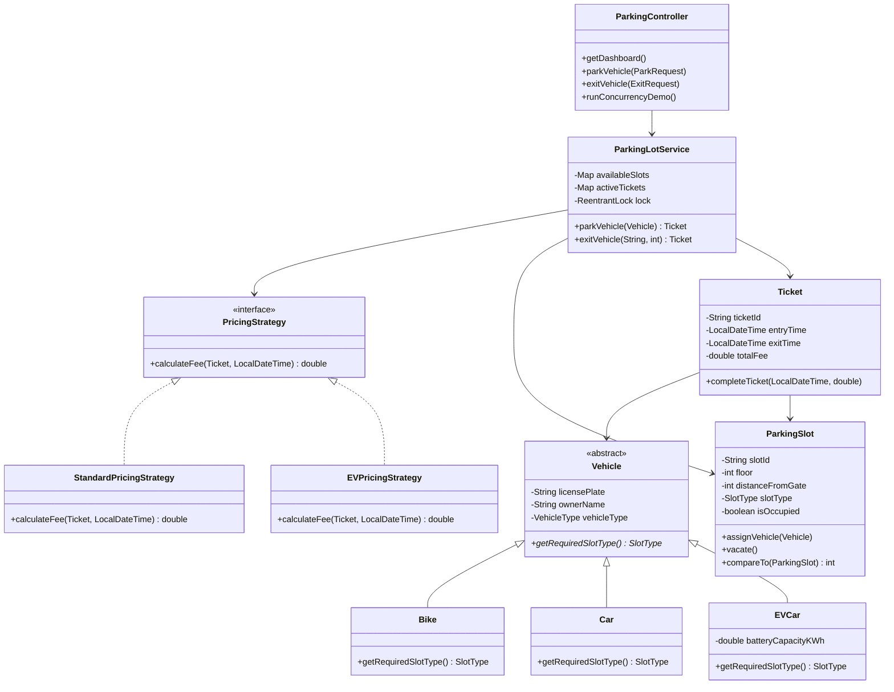

# 🚗⚡ ParkSmart EV — Smart Parking & EV Charging Allocation System

A full-stack **Java + Spring Boot** web application that manages multi-floor vehicle parking and EV charging slots using **Object-Oriented Design Patterns**, **Min-Heap nearest-slot allocation**, and **thread-safe concurrency control**.

---

## ✨ Key Engineering Features
* **Nearest-Slot Allocation ($O(\log N)$):** Uses a `PriorityQueue` (Min-Heap) per slot type to automatically assign the closest available slot to the entry gate.
* **Thread-Safe Gate Concurrency:** Uses Java `ReentrantLock` to prevent race conditions when multiple vehicles enter from different gates simultaneously.
* **Dynamic Billing (Strategy Pattern):** Polymorphic pricing engine supporting hourly rates for Bikes (₹20/hr), Cars (₹40/hr), and EV Cars (₹40/hr + kWh-based charging fee).
* **Live Control Center Dashboard:** Interactive web dashboard displaying real-time floor maps, KPI metrics, active tickets, and digital receipts.

---

## 🏗️ OOP & System Architecture (UML Class Diagram)



---

## 🛠️ Tech Stack
* **Backend:** Java 17+, Spring Boot (Spring Web REST API)
* **Frontend:** HTML5, CSS3, Vanilla JavaScript (`fetch` API)
* **Core Concepts:** OOP (Abstraction, Inheritance, Polymorphism, Encapsulation), Strategy Pattern, Min-Heap (`PriorityQueue`), Java Concurrency (`ReentrantLock`), Custom Exceptions

---

## 🔌 REST API Endpoints

| Method | Endpoint | Description |
| :--- | :--- | :--- |
| `GET` | `/api/parking/dashboard` | Fetch live slot grid, KPI metrics, revenue, and active tickets |
| `POST` | `/api/parking/park` | Assign nearest available slot and generate a ticket |
| `POST` | `/api/parking/exit` | Calculate dynamic bill, free slot, and return receipt |
| `POST` | `/api/parking/concurrency-demo` | Simulate simultaneous multi-gate entry using threads |

---

## ▶️ How to Run Locally
1. Clone the repository:
   ```bash
   git clone https://github.com/YOUR_USERNAME/smart-parking-ev.git
   cd smart-parking-ev
   ```
2. Run the Spring Boot application:
   ```bash
   ./mvnw spring-boot:run
   ```
   *(Or run `SmartparkingApplication.java` directly in IntelliJ IDEA.)*
3. Open your browser and visit: **`http://localhost:8080`**